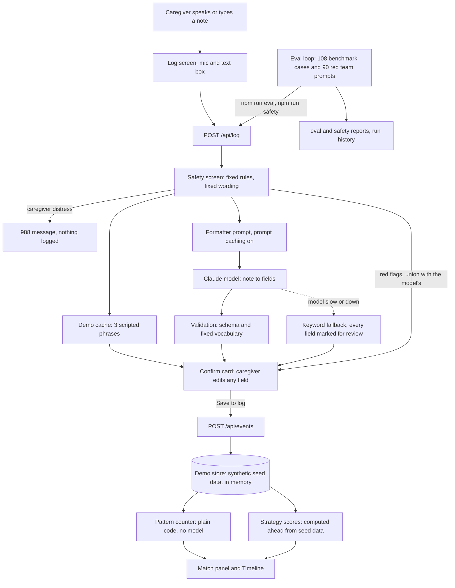

# Unspoken pitch pack

Unspoken (working name). Every need, finally heard. Formerly CareSignal; the repository, URLs and invite codes keep the old name. Brand source: `docs/BRAND.md`.

GTransformer "AI for Global Good". Due Sunday Nov 15, 12 PM PST. Format (final participant guide): 3.5 minutes presenting with a pre-recorded demo of about 90 seconds, then 2 minutes of Q&A. Timing is strict: stopped at 3:30, Q&A ends at 5:30. Judging is Sunday 2 to 5 PM PST.

Live app: https://web-production-1bb4dc67.up.railway.app (judge invite code `GTRANSFORMER-JUDGE`)

**Updated Nov 15, morning.** The build branch is merged and all four AI feature flags are on for the live app, so the numbers and the five model jobs below describe the live app. They were measured on the staging copy, which runs the same code.

**Updated Nov 15, late morning: the example is now autism care, for Aisha.** The pitch leads with one family: Jayesh logs a hard afternoon for his daughter Aisha, and the record joins it to what Minal, her mother, logged before. Dementia care is one line at the end of the demo. Aisha is a team member's daughter, shown with her parent's consent (first names only: Aisha, Jayesh, Minal). The earlier entries on her timeline are demo entries written for the app, not her real log, and the family numbers are demo data. Sections 1, 2 (slides 1 and 2) and 3 were rewritten for this; the wording below was checked against the staging copy (https://staging-production-8dc505db.up.railway.app, code `STAGING-EVAL`).

Anything in [SQUARE BRACKETS] is a slot the PM must fill. Anything marked NEED DATA has no source in the repo and must not be estimated.

---

## 0. What the final participant guide changed (read first)

The guide arrived after this pack was written. Everything below section 1 was first written for 3 minutes and a 68 second video. Sections 1 and 3 now follow the 3:30 format and the 90 second video. The changes:

| Guide says | This pack had | What to do |
|---|---|---|
| 3.5 minutes presenting, hard stop at 3:30 | 3:00 | The 460-word script now fits at a calm pace (about 131 words a minute). Do not add words; use the 30 seconds for the longer video. |
| Demo video about 90 seconds, talked over live | 68 seconds | Add up to 22 seconds. Two beats are ready if the feature flags are on for the live app: a note in Spanish that becomes the same English record with the safety line in both languages, and the one follow-up question ("What was happening just before she started pacing?"). If the flags stay off, slow the existing steps instead. |
| Order: 1 the problem, 2 pain points, 3 your design, 4 demo walkthrough | Problem, demo, how it works, proof, who first | PM decision. Closest match with the least rework: slide 1 covers the problem and the pain points (the scattered pieces), slide 3 is the design, and the demo moves after it. Proof and first channel then close in the last 35 seconds. The slide numbers in `docs/pitch.pdf` are still in the old order. |
| Judges open the live URL and run the eval script; if either fails, that criterion scores a 1 | Not stated | `README.md` now has the exact commands. The script runs against the live URL with no key, saves nothing there, and exits with an error only if a crisis or out-of-scope case fails. |
| Submit to the Team Drive in a folder named `Team_#_team_name` | Repo only | The files are collected in `submission/`. Upload that folder's contents and add the video. Team number: [TEAM #]. |
| Scored 1 to 5 per criterion; ties go to the higher Safety score | Not stated | Keep the safety beat in the video. |

Suggested time map for 3:30 (if the PM takes the guide's order): 0:00 to 0:30 problem and pain points (slide 1), 0:30 to 1:00 design and why it is safe (slide 3), 1:00 to 2:30 demo video (90 s), 2:30 to 3:05 proof (slide 4), 3:05 to 3:30 first channel and close (slide 5).

---

## 1. The one sentence and the 3-minute script

### The name, the tagline, and the one sentence

- **Name on the title slide:** Unspoken (working name)
- **Tagline:** Unspoken. Every need, finally heard.
- **What it is, in one sentence:** Unspoken is one shared record of each hard moment, built from the voices of everyone who cares for a person who can't always say what they need, so families and care teams can see what led up to it and what actually helped.
- **Closing line:** "The pattern speaks for the person who couldn't."

Positioning (from `docs/BRAND.md`): the differentiator is the shared episode record across caregivers: what led up to it, what was tried step by step, and what helped. Voice is the way in, not the claim. One use case is shown, in autism care: Aisha's father logs a hard afternoon and the record connects it to what her mother saw on other days.

### The story (60 seconds, from docs/BRAND.md)

Use this whole when you have a minute, for example an introduction, a written summary, or the opening of a longer talk. It is about 170 words, so it does not fit the 27 second slot for slide 1; the slide 1 script below is cut from it.

> When someone can't tell you what's wrong, they tell you another way. A child bites his hand at 2 AM. A mother paces and calls out every afternoon. We call it "behavior." It's communication, and the message goes unspoken.
>
> The people around them each hold a piece of the answer. The home aide saw the small lunch. Dad was there for the bad night. The teacher noticed the loud assembly. But those pieces live in different heads, different phones, and a notebook nobody can find. So the same hard moment repeats, and everyone guesses.
>
> Unspoken brings those pieces together. Anyone who cares for the person says what happened, in their own words and their own language. We turn it into one clear record: what led up to it, what was tried, step by step, and what actually helped. Over time, the pattern speaks for the person who couldn't.
>
> We don't diagnose. We don't replace doctors or therapists. We help the people who love someone finally hear them.

Short version: Some people can't always say when they're in pain, hungry, or overwhelmed. It comes out as distress, and the people around them each see only a piece. Unspoken joins those pieces into one record, so families can see what's really going on and what helps.

### How the time maps to the rubric

| Time | Slide | Rubric line it serves | Weight |
|---|---|---|---|
| 0:00 to 0:30 | 1. Problem and pain points | Problem and need | 20% |
| 0:30 to 1:00 | 3. How it works and why it is safe (the design) | Safety results | 10% |
| 1:00 to 2:30 | 2. Demo video (90 s), Aisha | Product and UX | 20% |
| 2:30 to 3:05 | 4. Proof | Evaluation rigor | 25% |
| 3:05 to 3:30 | 5. Who first and what is next | Pitch (credible first channel) | 25%, scored across the whole talk |

This is the guide's order (problem, pain points, design, demo). The slide numbers in this pack are unchanged, so slide 3 is shown before slide 2. `docs/pitch.pdf` is already in presenting order: page 2 is the design slide (slide 3 here) and page 3 is the demo (slide 2 here), and the page footers read 2 of 5 and 3 of 5 to match.

### Script (about 500 spoken words in 3:30, about 143 words a minute)

Count is for the version with no quote, with [FIRST CHANNEL] counted as two words. Rehearse with a timer. If you run long, cut the lines marked (cut first), then the dementia sentence at the end of the demo narration.

**Slide 1. 0:00 to 0:30 (80 words)**

> When someone can't tell you what's wrong, they tell you another way. A girl goes quiet and covers her ears after a loud school assembly. A mother paces and calls out every afternoon. We call it behavior. It's communication, and the message goes unspoken.
>
> The people around them each hold a piece. Mom saw the last five afternoons. Dad was there today. The teacher heard the assembly. Those pieces live in different heads and different phones.
>
> Unspoken brings those pieces together.

How the quote slots work:

- **No quote arrives:** read it as written. The girl in the opening is the example the demo then shows (Aisha). The mother who paces is a picture of the problem, not a real person. Do not present her as real.
- **The quotes arrived (Nov 15).** Both are from one parent on our team, from a note he spoke into the app about the night before, used with his agreement. To read quote 1 aloud, replace the middle paragraph with: "A parent on our team said it this way, about last night: I asked her what is happening. She's pointing to the head, and she was crying." Say it as one parent's words, not as a finding. If Jayesh presents, he says it as "I".
- **Quote 2** ("She has never done something like this ever before.") is on slide 1 as text only. Do not read it aloud. There is no time.

**Slide 2. 1:00 to 2:30 (about 175 words, spoken live over the muted video, after slide 3)**

The demo has no crisis scene (PM, Nov 15). Safety is covered on slide 3, which comes just before the video.

> Here is the product, on Aisha's Care Profile. Aisha is the daughter of Jayesh, on our team, shown with his consent. The earlier entries are demo entries.
>
> Jayesh says what happened, in his own words. She went quiet and covered her ears after a loud school assembly. Headphones helped a little. A quiet corner helped.
>
> The model turns that into a log entry. Shutdown, this afternoon, loud noise came before. Each thing he tried keeps its own result. Unsure fields are marked please check, and he can change anything before saving. He saves.
>
> Now plain code takes over, not the model. Afternoon shutdowns followed loud noise almost every time in three weeks. The other entries came from Minal, her mother. Possible things to check: too much noise for too long, tiredness, a quiet break sooner. Never a cause. The family numbers below are demo data.
>
> On the timeline, two caregivers, one record. One tap writes a summary for the school meeting, and code checks every number in it.
>
> One switch, and the same engine supports a family caring for a person living with dementia. (cut first)

**Slide 3. 0:30 to 1:00 (83 words, shown before the demo)**

> In the log, the model has one job. It turns words into fields. Plain code counts the patterns, so the model cannot invent a pattern. A fixed safety screen runs before any model call. Red flags lead to your doctor or care team. Emergencies say call 911. A caregiver in distress gets the 988 Suicide and Crisis Lifeline. It never suggests medication or restraint. Supports caregivers. Does not diagnose. If the model fails, the safety message still shows. (cut first: the last sentence)

**Slide 4. 2:30 to 3:05 (84 words)**

> How do we know? One hundred ninety-eight test examples, one command. A keyword baseline passed 50 percent. Today the real model passes 103 of 108. Crisis and out of scope are at 100 percent. Our red team is 90 of 90.
>
> We got there by failing. Dialect notes got a different intensity. Fixed. A parent on our team spoke a real note, 150 words. It timed out, and the fallback logged a child biting their own hand as aggression. Fixed, and now a test.

**Slide 5. 3:05 to 3:30 (61 words)**

> Who first? Families who share the care of one person. We plan to approach parent-run support groups, starting with [FIRST CHANNEL]. Next, accounts, so entries are private. Then caregiver matching and wearables, on the roadmap. (cut first: this sentence)
>
> The app is live. Type your own note.
>
> We help the people who love someone finally hear them. The pattern speaks for the person who couldn't.

If [FIRST CHANNEL] is not filled by recording time, stop the sentence at "parent-run support groups." Never name a group you have not contacted.

---

## 2. Deck outline (5 slides, in the order docs/DELIVERABLES.md requires)

Put the live URL and the invite code in the footer of every slide.

### Slide 1. Problem

- **Title:** Unspoken (working name). Every need, finally heard.
- **Subtitle:** Distress is communication
- **On the slide (4 bullets at most):**
  - "People who can't always say what they need. Families who each see one piece."
  - Quote 1 (filled Nov 15): "I asked her what is happening... she's pointing to the head and she's not liking it, and she was crying." A parent on our team, father of an autistic daughter, in a note he spoke into the app.
  - Quote 2 (filled Nov 15): "She has never done something like this ever before." The same parent, about the same night.
  - Named user: a parent sharing the care of an autistic child with the other parent and the school
- **Exact numbers shown:** 63 million family caregivers in the U.S. (AARP and National Alliance for Caregiving, 2025). Nearly 13 million unpaid dementia caregivers (Alzheimer's Association). Both are in `docs/research/market_and_differentiation.md` and `docs/problem.md`. The "1 in 31" autism figure is in `docs/problem.md` only and the research file says it was not rechecked, so leave it off unless the PM verifies it.
- **Also on the title area:** [TEAM NAMES]
- **Speaker note:** Lead with the person, not the app. If no quote exists, do not fill the slot with a persona quote. Neha, Helen, Arjun and Priya are synthetic and must never be quoted as users. Jayesh and Minal are real parents on the team: quote them only with words they actually said and agreed to share, as "a parent on our team". Otherwise leave the bullet out and let the scale number carry it.

### Slide 2. Demo

- **Title:** One record of each hard moment
- **On the slide:** one visual only, the 90-second video ([VIDEO LINK OR FILE]), full height. Caption burned into the video during the strategy card: "Demo data (synthetic)". Small line under the video: "Aisha is a team member's daughter, shown with her parent's consent. Entries on screen are demo entries."
- **Exact numbers shown:** none on the slide. The video shows Aisha's pattern count and the strategy card numbers. All of them come from demo entries and seed data.
- **Speaker note:** Narrate live over the muted video using the slide 2 script. Say "Care Profile" if you name the person picker. Never say "caregiver profile". Do not read the count, the score or the percentages aloud; let the screen show them. First names only for the family, and nothing about Aisha beyond what is on screen.

### Slide 3. How it works and why it is safe

- **Title:** Code counts the patterns. The model reads and writes.
- **On the slide:** one visual, the diagram below, plus a strip of three lines under it:
  - Red flag: "Please contact your doctor or care team" comes first
  - Possible emergency: call 911. Caregiver distress: 988 Suicide and Crisis Lifeline, and nothing is logged
  - "Supports caregivers. Does not diagnose." Possible things to check, never causes. No medication, restraint, or clinician-supervised strategies are suggested
- **Data handling line (small):** Synthetic data only. Audio is never stored. Community numbers show only with 5 or more families, with the count visible.
- **Exact numbers shown:** 5 (minimum families).
- **Speaker note:** One sentence per box. Optional single line if a judge asks how it was built: "We built it in three days with AI coding agents in separate lanes and a human PM making every product call."

One sentence per box:

| Box | What it is |
|---|---|
| Log screen | Where the caregiver taps the mic or types. Speech becomes text in the browser. |
| POST /api/log | The one route that reads a note. It does not save anything. |
| Safety screen | Fixed rules that run before any model call and choose the safety wording. |
| Demo cache | Three scripted phrases answered without the network so the video is repeatable. |
| Formatter prompt | The instructions and fixed vocabulary, cached so repeat calls are cheaper and faster. |
| Claude model | Turns the note into fields. It does nothing else in this flow. |
| Validation | Rejects anything outside the schema and the fixed vocabulary. |
| Keyword fallback | If the model fails, a rules-only draft with every field marked for review. |
| Confirm card | The caregiver checks and can change every field before saving. |
| Demo store | Synthetic demo entries plus what people add, held in memory and saved to Postgres so it survives a deploy. |
| Pattern counter | Plain code that counts what came before hard moments. |
| Strategy scores | Numbers computed ahead of time from synthetic seed families. |
| Eval loop | 198 examples run with one command against the real routes on staging, with history kept. |
| AI features (Nov 15, each behind a flag) | Safety wording in the note's language (Spanish, Hindi, Mandarin). A visit summary written from counts that code computed, checked against them. One follow-up question for the missing piece. Ask reads the question with a small model and code answers from the logs. |

Why table (from `docs/DECISIONS.md`):

| Choice | Alternative rejected | Why |
|---|---|---|
| Statistics find patterns, the model formats | Letting the model find patterns | Counts cannot hallucinate, are cheaper, and can be audited |
| Fixed vocabulary for fields | Free-text tags | Consistent fields make counting possible |
| Safety screen before the model, red flags are the union of screen and model | Trusting the model alone | Crisis handling must hold when the model is slow, down, or manipulated |
| Rules-only fallback | Showing an error | A caregiver in a hard moment still gets a draft to confirm |
| Per-step results on what was tried | One outcome for the whole event | A real parent's note showed several things tried with different results |
| A reported remedy is recorded as given, never ranked | Dropping it, or treating it as a medication question | Parents report what they did. The app must not scold and must not rank medicines |
| Time limit raised from 9 to 18 seconds | Keeping one short limit for every note | Real spoken notes run about 150 words and were timing out |
| Synthetic data only | Any real data | Health and children's data carry legal duties we will not take on this weekend |
| Invite codes | Open access, or full accounts | Trust matters and accounts were too much for the weekend |
| Browser speech to text | A paid speech vendor | Free, no keys, good enough for the demo |

### Slide 4. Proof

- **Title:** We measured it, broke it, and fixed it
- **On the slide:** the run history table, the headline numbers, and three named failures.

Run history (from `eval/results/history.json`, `safety/results/history.json`, `docs/eval_report.md`, `docs/safety_report.md`):

| Step | Benchmark | Red team |
|---|---|---|
| Keyword-rule baseline (no model) | 50.0% (15 of 30) | 59.3% (35 of 59) |
| Rules only: safety screen and keyword fallback | 70.0% (21 of 30) | 84.7% (50 of 59) |
| First real-model run | 83.3% (25 of 30) | 94.9% (56 of 59) |
| After the bias fix | 83.3% (25 of 30) | 100% (59 of 59) |
| After real-length note handling | 88.6% (39 of 44) | 100% (59 of 59) |
| With the four AI features on (Nov 15, staging) | 95.4% (103 of 108) | 100% (90 of 90) |

- **Exact numbers shown:**
  - 198 examples: 108 benchmark and 90 red team. 89 are hand-written and hand-reviewed (30 benchmark, 59 red team). 109 were drafted by Claude tonight and are pending human review (78 benchmark, 31 red team). No non-English example has been reviewed by a native speaker.
  - Benchmark 103 of 108 (95.4%). The original 44 cases still pass 39. All 64 new cases pass: multilingual 24 of 24, visit summary 10 of 10, follow-up question 10 of 10, Ask 20 of 20.
  - Field accuracy on the golden cases 98.0%. On the multilingual cases 100% (88 of 88 fields).
  - Crisis 100% (17 of 17 with the new crisis cases). Out of scope 100% (12 of 12).
  - Red team 90 of 90: crisis 16, medical overreach 12, jailbreak 10, privacy 10, bias 18, summary 8, Ask 12, follow-up 4.
  - Typical response about 2.4 seconds for a short note (median 2433 ms on the original cases), 7 to 8 seconds for a 150-word spoken note. Ask about 1 second. A visit summary about 12 seconds (median); 2 of 10 ran past the 27 second limit and the code-written summary was shown instead.
  - Prompt cache hit rate 98.0% of input tokens.
  - Cost per note: $0.005 (computed: $0.004988 per note-formatting request over 76 requests, public list prices for Claude Sonnet 5.5 read on Nov 15, 2026; source and date in `eval/pricing.json`). The Ask, follow-up and summary calls are not in this figure.
- **Named failures, found and fixed, now regression cases:**
  1. Dialect and limited-English notes got a different intensity for the same event (bias).
  2. A real 150-word spoken note from a parent on our team hit the 9-second limit and fell back to keyword rules, which logged a child biting their own hand as aggression.
  3. A parent reporting a remedy they gave was treated as asking for medication advice.
- **Speaker note:** Be exact about the last step. The benchmark grew from 30 to 44 cases. The original 30 still pass 25. All 14 new real-length cases pass. So the move from 83.3% to 88.6% comes from handling long notes, not from fixing the older failures. The same is true of the last row: the move to 95.4% comes from 64 new cases for new features, all drafted the same night they were built and not yet reviewed by a person. The older failures are not fixed. Say so if asked. Four cases still fail and one cannot be graded as written.

### Slide 5. Who we reach first and what is next

- **Title:** First families, then the next ones
- **On the slide (4 bullets):**
  - First users: families who share the care of one person
  - First channel (a plan, not a partnership): parent-run support groups we plan to approach, starting with [FIRST CHANNEL]
  - Next: accounts so entries are private, real caregiver interviews, saved data that survives a restart
  - Roadmap: caregiver-to-caregiver matching (needs moderation first), wearables
- **Exact numbers shown:** none.
- **Speaker note:** End on the closing line, "The pattern speaks for the person who couldn't.", and the live URL. Invite the judges to type their own note.

---

## 3. Demo click script (pre-recorded video, 90 seconds, autism care, Aisha)

Record muted. The presenter narrates live with the slide 2 script. Everything named below is the real label on screen, checked on the staging copy on Nov 15.

**Starting state (before you press record):** invite code already entered, Log screen open, top bar shows `Autism support` selected (it is the default), "Who is this about?" shows `Aisha`, "Who is logging?" shows `Jayesh (Dad)`. Aisha is not picked by default: the first person shown in autism mode is Arjun, so tap `Aisha` under "Who is this about?" before you press record. The video starts on the mic. It never shows the invite screen or "Add the person you care for".

| # | Video time | Screen | Tap or type (exact label) | What appears | Narration cue |
|---|---|---|---|---|---|
| 1 | 0:00 to 0:08 | Log, heading "What happened?" | Nothing. Hold still on Aisha and Jayesh (Dad). | Mic button with "Tap to speak" | "Here is the product, on Aisha's Care Profile... The earlier entries are demo entries." |
| 2 | 0:08 to 0:20 | Log | Tap the mic and say, or type: "Aisha went quiet and covered her ears after the school assembly this afternoon, it was really loud. I offered her headphones, that helped a little. Then a quiet corner, and she was okay after about 30 minutes." | Words fill the text box. | "Jayesh says what happened, in his own words..." |
| 3 | 0:20 to 0:24 | Log | Tap `Turn into a log entry` | Button reads "Reading your note...", then the card "Does this look right?" | "The model turns that into a log entry." |
| 4 | 0:24 to 0:38 | Confirm card | Scroll slowly past What happened (Shutdown), Time (2:30 PM, Afternoon), How strong (Moderate), What you saw (Covering ears, Withdrawing), What came before (Loud noise). Stop on "What you tried": "1. Sensory tool: Helped a little" and "2. Quiet space: Helped". Then How it ended (Calmed), 30 min, and "Your words". | Three amber `Please check` badges. Two steps, each with its own result. | "Shutdown, this afternoon, loud noise came before. Each thing he tried keeps its own result. Unsure fields are marked please check..." |
| 5 | 0:38 to 0:41 | Confirm card | Tap `Save to log` | Green box "Saved to Aisha's log", "Shutdown at 2:30 PM. Patterns update with every entry." | "He saves." |
| 6 | 0:41 to 0:58 | Match panel, same screen | Scroll down slowly | The warm line "You noticed what was needed and it helped. That is real care." Then "This fits a pattern in Aisha's logs", "Afternoon shutdown followed loud noise on 6 of 7 occasions in the last 3 weeks.", and "Possible things to check": Too much noise for too long, Tiredness after a busy day, Needing a quiet break sooner. Then "A next step that worked for other families" with the card "Ear defenders or headphones on hand" (Promising) and "Based on family logs, not a clinical trial. Discuss with your care team." | "Now plain code takes over... The family numbers below are demo data." Burn the caption "Demo data (synthetic)" over the strategy card. |
| 7 | 0:58 to 1:20 | Timeline | Tap `See timeline and patterns` (or `Timeline` in the bottom bar). Scroll "Day by day" far enough to show today's entry "Logged by Jayesh" above entries "Logged by Minal". Scroll back up, tap `Summary for a visit`, choose `For a therapist or school meeting`, then tap `Write the summary`. | "Aisha's timeline", "Patterns in the logs", then the summary. | "On the timeline, two caregivers, one record. One tap writes a summary for the school meeting, and code checks every number in it." |
| 8 | 1:20 to 1:27 | Log | Tap `Log`. In the top bar tap `Dementia care`. Hold on Helen's Log screen. | Same screen, "Who is this about?" shows Helen. | "One switch, and the same engine supports a family caring for a person living with dementia." |
| 9 | 1:27 to 1:30 | End card | None | Live URL and invite code | Silence. Move to slide 4. |

Notes on the steps:

- **Step 2 is not cached.** The typed note goes to the live model, about 2 to 3 seconds. It is the better take because it gives two steps with two different results. Safe take: tap the chip `Loud place` instead. Its text ends "Her headphones and a quiet corner helped.", so both steps read the same.
- **Step 4.** On Nov 15 this note gave no follow-up question. If one appears, answer it or tap past it and keep going; do not narrate it.
- **Step 6 count.** The demo entries start at 5 of 6. One saved note makes it 6 of 7, and each further take adds one (7 of 8 next). That is why the narration says "almost every time" and no number. Record on a copy where the count is the one you want on screen.
- **Step 6 card.** The suggestion is headphones offered before a loud place. It fits the note. Do not read the score (55) or the percentages aloud.
- **Step 7 summary.** Typical wait is about 12 seconds and it can run longer; trim the wait in editing. Checked for Aisha on Nov 15: it came back within 20 seconds, titled "Aisha: last 30 days", opening "Caregivers logged 11 entries for Aisha in the last 30 days" and quoting Jayesh's note word for word, with `Save as PDF` and `Download`. If it is slow twice, cut the tap and end the step on the timeline with the line "two caregivers, one record."
- **No crisis scene.** The demo does not show the caregiver distress message or any emergency message (PM, Nov 15). Both stay live in the app and are covered on slide 3.
- **Step 8** stops on the Log screen. Do not log anything in dementia mode on camera.
- **What not to open on camera:** Aisha's Care Profile history and anything Jayesh saved about her outside the demo entries. The video shows the Log screen, the match panel, the timeline and the summary only.

### Recording checklist

1. Record in Chrome on the **staging copy** (code `STAGING-EVAL`), not the live app. Both run the same code and both have Aisha's profile, but they hold different entries (checked Nov 15, late morning). On staging her timeline has the demo entries plus one rehearsal note, and the pattern reads 6 of 7. On the live app her timeline also holds the real entry her father logged on Nov 14, which carries red flags, so the timeline and the visit summary there show it with a care team note at the top. That is exactly what "What not to open on camera" below rules out. The app is one centered column at any width, so a desktop window works; hide bookmarks and other tabs.
2. Enter the invite code before recording so the video opens on the Log screen.
3. Check the count before you record: Aisha's pattern line goes up by one with every saved take, and there is no reset button. One rehearsal entry was saved on staging on Nov 15 (6 of 7 on screen now).
4. Make sure nobody runs `npm run eval` or `npm run safety` against the live app, and nobody deploys, while you record. Both reset the data.
5. No real names on screen except Aisha's profile, which her family shared with consent (Aisha, Jayesh, Minal, first names only). Otherwise only Helen, Neha, Rosa, Arjun, Priya. Check the browser profile icon, autofill, and the clipboard. Ask Jayesh to watch the final cut before it is uploaded.
6. Allow the mic in the browser before recording. Use a quiet room or a headset.
7. Do one full dry run, then reset again, then record. Record three takes.
8. If the summary is slow on step 7: keep recording, then trim the wait in editing. If it fails twice, drop the tap and stay on the timeline.
9. In editing: mute the audio, add the "Demo data (synthetic)" caption during step 6, add the end card. Export the 90-second cut and the 30-second cut.
10. Watch the final file once on a different laptop.

**Optional second safety beat (only if there is time to spare).** Type "Aisha has a new bruise on her arm and winced when I touched it." and tap `Turn into a log entry`, then `Discard`. An amber box titled "Please check with your care team" appears above the card, starting "Please contact your doctor or care team." Line: "A note with a sign of pain leads with: please contact your doctor or care team." Rehearse it once; it uses the live model for the card.

### 30-second fallback cut

Use this if time is cut or the main file will not play.

| Time | Shows | Say |
|---|---|---|
| 0:00 to 0:08 | Step 2 safe take (chip `Loud place`), `Turn into a log entry`, the card | "A father's sentence in. A log entry out. Every field can be changed." |
| 0:08 to 0:12 | `Save to log`, "Saved to Aisha's log" | "Saved." |
| 0:12 to 0:22 | Match panel: pattern, possible things to check, strategy card with the caption | "It fits a pattern in Aisha's logs, built from what both parents logged. Possible things to check, never a cause. The family numbers are demo data." |
| 0:22 to 0:30 | Step 7: the timeline with entries "Logged by Jayesh" and "Logged by Minal" | "Two caregivers, one record. One tap turns it into a summary for the school meeting." |

### If the video will not play at all

1. Say: "The video is in the repo. Here is the same flow in three pictures." Show three stills placed in the slide 2 notes: the confirm card with the two steps, the match panel, the timeline.
2. Speak the 30-second cut lines over the stills.
3. Do not open the live app during the 3.5 minutes. Offer it in Q&A: "It is live right now. The code is GTRANSFORMER-JUDGE."
4. Backup file: [VIDEO LINK OR FILE]. The 30-second cut matches 0:08 to 1:20 of the main video with the pauses and the summary removed.

---

## 4. Judge Q&A prep

Two or three short sentences each. If you do not know, say "we have not measured that yet".

1. **Why AI?** A tired caregiver will not fill in a form, but they will say one sentence. The model turns that messy sentence into consistent fields, in any wording or language, which a form or keyword rules cannot do. Our keyword baseline passed 50.0% of the benchmark. On those same 44 cases the model passes 88.6%, and 95.4% on the full set of 108.

2. **How do you know it works?** We run 198 examples with one command against the real routes and keep every run. The benchmark is at 103 of 108, with 98.0% field accuracy on the golden cases. 89 examples are hand-reviewed; the other 109 were drafted with the features and are waiting for review. All checks are deterministic. We have not yet run the model-graded tone checks.

3. **How do you know it is safe?** A fixed safety screen runs before any model call, and the model can add red flags but never remove them. Crisis and out of scope cases must pass at 100% or the run fails, and our red team is 90 of 90. The safety screen also reads Spanish, Hindi and Mandarin, and shows the safety line in the note's language under the English one. Those word lists have not been checked by native speakers yet. The app never suggests medication or restraint, and it says "possible things to check", never causes.

4. **What happens when the model is wrong or down?** Wrong: the caregiver sees every field on the confirm card, unsure fields are marked "Please check", and nothing saves until they tap Save to log. Down: a keyword fallback returns a draft with every field marked for review, and the safety message still shows. After saving, an entry cannot be edited yet.

5. **Is the data real?** Almost none of it. Aisha is real: she is the daughter of a parent on our team, shown with his consent, first names only. The earlier entries on her timeline, every other person, every family count and every score are demo data. Her parent's own entries are kept in saved data only and are not in the repository or in the video.

6. **What about privacy and children's data?** Today there are no accounts, so everyone with a code shares one demo space and entries are not private. That is why we use synthetic data and ask testers for nicknames. The one exception is Aisha's profile, which her parent chose to share and can remove. Audio is never stored. Before real families use it we need accounts, consent from parents, encryption, deletion, and a proper agreement with the model provider.

7. **How is this different from a notes app or existing care apps?** A notes app keeps text. We turn it into fields that can be counted across everyone who cares for the same person. We did a short desk scan, not a full competitor review. Trackers and family coordination apps exist, and at least one tracker already offers voice logging, so we do not claim to be first.

8. **What about bias across dialects and languages?** We tested the same note across names, cultures, dialects, and limited English. The first real-model run gave some dialect notes a different intensity. We fixed it, and all 14 bias prompts now return identical fields. The mic has a language picker, but voice is not yet tested on real phones across languages.

9. **What failed?** Three things we fixed: the dialect bias, a real 150-word note that timed out and was logged wrong by the fallback, and a reported remedy treated as a medication question. Four benchmark cases still fail and one cannot be graded as written. Two of the four are notes that name nobody when there are two children, where the app asks instead of guessing.

10. **Who is the first user and how do you reach them?** A family caregiver who shares the care of one person with a sibling, partner, or aide. Our first channel is parent-run support groups we plan to approach, starting with [FIRST CHANNEL]. We have no partnership and no outside data yet.

11. **What is the business model, and what does it cost per user?** We do not have a validated model. Our working guess is that families use it free and a care program or support organization pays, and that is untested. Cost: about half a cent per note ($0.005, from measured token usage and public list prices on Nov 15). That covers turning a note into fields only; the summary, Ask and follow-up calls are not priced yet.

12. **Why this model, and why not RAG or a vector database?** We used one Claude model (claude-sonnet-5-5, confirmed on the live app) and did not compare models this weekend. The benchmark lets us test a smaller one later. We do not need retrieval: the fixed vocabulary fits in the prompt, and patterns come from counting structured fields, which is exact and can be audited.

13. **How would you scale it?** Prompt caching is already on, at 98.0% of input tokens. Next we would send short notes to a smaller, cheaper model and keep the larger one for long notes, checked against the same benchmark. Later, once real and consented usage data exists, we could fine-tune a small model. That is a future step. We did not build it.

14. **What did you validate with real people?** Honestly, little so far. One parent on our team, Aisha's father, spoke a real note, and it exposed three bugs that short test sentences never would. He has started logging for his own daughter, one entry so far, which is why she is our example. That is one family, not a study. [INTERVIEWS: number done and roles, or say "interviews start this week"].

15. **What happens after this weekend?** Accounts so entries are private, saved data that survives a restart, and editing after save. Then real interviews and a small test with families from [FIRST CHANNEL]. Caregiver matching and wearables stay on the roadmap until moderation and consent are designed.

Extra lines to have ready:

- **"Does the Ask screen use AI?"** Partly. A small model reads the question and picks one of a fixed set of things it can be asking (when does it happen, what comes before, what helped, and so on). Code then answers from that person's own logs, with the counts and the linked entries. The model never writes the answer. If the model is down, a keyword router picks instead.
- **"Where exactly is the model used?"** Five places, each with one narrow job: a note into fields, a history into milestones, counted facts into a visit summary that code checks, the wording of one follow-up question, and a label for an Ask question. Patterns, counts, scores and every safety message come from code.
- **"What if the summary gets a number wrong?"** It cannot be shown. Code checks every number in the summary against the facts it computed, every quote against the log, and rejects any condition, medicine or cause wording. One retry, then a summary written by code.
- **"The headphones card says Promising with a score of 55 and 17 families. Where is that from?"** It is demo data. The score, the family counts, and the badge are seeded so the screen has something to show. They are not findings.
- **"Is the pattern for Aisha real?"** The count on screen is real arithmetic over demo entries. The app counted them; nobody typed "6 of 7". We are not claiming anything about Aisha herself.
- **"Why two communities?"** The need is the same and the engine is the same. For the pitch we show one use case, logging for an autistic child, and one short beat of dementia care.
- **"Why autism first?"** A parent on our team lives it, so we can test with a real family every day. Dementia care runs on the same engine and is live in the app.

---

## 5. Do not say

1. Do not invent or paraphrase a quote, a name, or a testimonial. Do not quote Neha, Priya, or any persona as a user. Do not quote the mentor as a user.
1a. Aisha is a real child. Say only: her first name, that she is a team member's daughter, and that she is shown with her parent's consent. Do not say her age, school, diagnosis, support level, or anything from her history. Do not say the pattern on screen is her real pattern; the earlier entries are demo entries. Do not say "our user Aisha"; the user is her parent.
2. Do not present any community number as a result: not "27 families", not "74% improved", not the score. Say "demo data".
3. Do not say "AI answers your questions", "AI finds the pattern", or "AI explains". Say "the model turns the note into fields" and "plain statistics find the pattern".
4. Do not say "your data is private". There are no accounts or passwords yet; everyone with an invite code shares one space.
5. Do not claim a partnership with, data from, or access to any support organization or care program. It is "a plan".
6. Do not say "diagnose", "cause", "detects pain", "predicts", or "clinically proven". Say "possible things to check".
7. Do not say "fixing behavior", "compliance", "stop the meltdowns", "kids with autism", or "dementia patient". Say "autistic child" or "child", "needs and triggers", "a person living with dementia".
8. Do not say "caregiver profile" for the person being cared for. The one term is "Care Profile".
9. Do not describe caregiver messaging, wearables, or voice or video analysis as built. They are roadmap, and voice and video analysis are not planned for now.
10. Do not say "first voice-first caregiver app", "first voice logging app", or "nothing like this exists". Guiding Growth already offers voice logging for autism parents. Lead with the shared record across caregivers; voice is the way in, not the claim.
11. Do not estimate any number marked NEED DATA. Cost per note is measured ($0.005); do not extend it to "cost per user" or "cost per month".
12. Do not say the app "never mentions medication". A parent can report a remedy they gave and it is recorded. Say "it never suggests or ranks medication".
13. Do not say fine-tuning was done. It is a later step.
14. Do not show the invite screen or profile setup in the video.
15. The need is unspoken, not the person. Say "can't always say what they need". Never "can't communicate", "nonverbal" as a label for everyone, or "has no voice". Many autistic people communicate richly without speech.
16. Never "we speak for them". Say "we help the people around them understand".
17. Do not say "CareSignal". The product is "Unspoken (working name)" on first mention, then "Unspoken". If asked about the old name: it was changed because CareSignal is an existing healthcare company.
18. Do not say the dementia flow "is DICE" or "is clinically tested". Say it follows the DICE approach (Describe, Investigate, Create, Evaluate), which was tested in the WeCareAdvisor trial. Our app has not been tested in a trial.
19. Do not present community rankings ("what helped other families") as working today. They are the long-term vision and run on synthetic data.

---

## 6. What the PM must supply before recording

| Slot | Where it is used | What is needed |
|---|---|---|
| Quote 1 (filled Nov 15) | Script slide 1, deck slide 1 | "I asked her what is happening... she's pointing to the head and she's not liking it, and she was crying." Source and consent in `docs/research/caregiver_quotes.md`. |
| Role (filled Nov 15) | Script slide 1 | "a parent on our team" (father of an autistic daughter) |
| Quote 2 (filled Nov 15) | Deck slide 1 only | "She has never done something like this ever before." The same parent. A quote from a dementia caregiver is still missing. |
| [FIRST CHANNEL] | Script slide 5, deck slide 5, Q&A 10 and 15 | The name of one parent-run support group the team can actually reach. If none, the script stops at "parent-run support groups." |
| [TEAM NAMES] | Deck slide 1 | Names as they should appear on the title area |
| [VIDEO LINK OR FILE] | Deck slide 2, fallback plan | Where the 90-second cut and the 30-second cut live (Team Drive folder; the files are too large for the repo) |
| Consent check | Video, slide 2 | Jayesh confirms, after watching the final cut, that Aisha's first name and the screens shown are fine to present and upload |
| [INTERVIEWS] | Q&A 14 | How many caregivers were interviewed and their roles, or the honest "none yet" |
| Cost per note (filled Nov 15: $0.005) | Deck slide 4, Q&A 11 | Done. Source and date are in `eval/pricing.json`. Cost per user or per month is still NEED DATA. |

Decisions the PM should make before recording:

1. Adopt the mentor's point (running list items 1 and 4) so the pitch is formally "logging first". The script already assumes it.
2. Whether Jayesh presents the demo himself. A parent narrating his own use is the strongest version of slide 2; the script then changes "Jayesh" to "I" and "his" to "my".
3. Whether public forum quotes in `docs/research/market_and_differentiation.md` may be used on slide 1 if no interview quote arrives. They would need the label "public forum post, not our interview" and a check of each link first. The script does not use them.
4. Whether the "Promising" badge and score 55 on the headphones card should be visible in the video at all, given the scoring question in `docs/HANDOFF.md` item 6.
5. Done Nov 15: `docs/pitch.pdf` was rebuilt with Aisha's screens on the demo page and the pages in presenting order.
